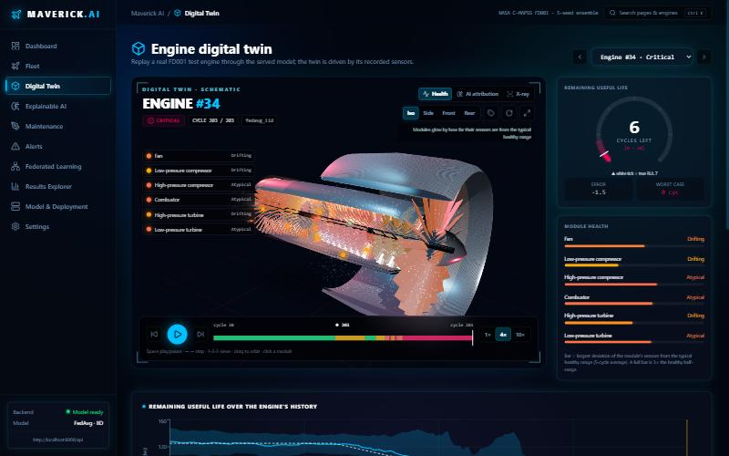
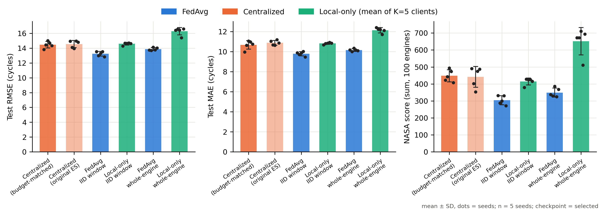
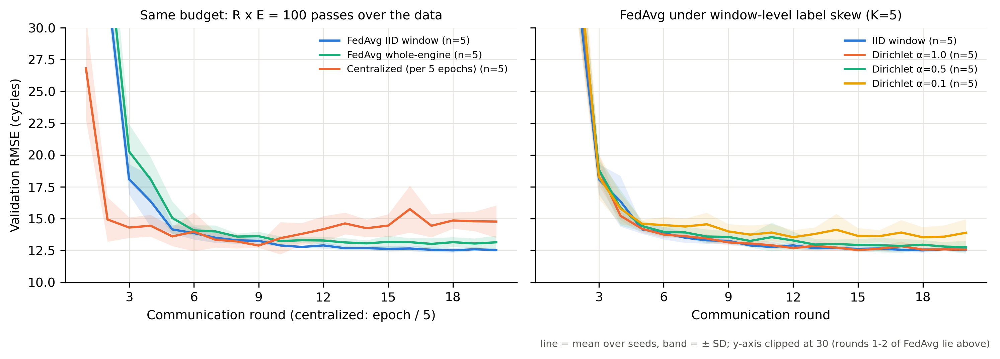
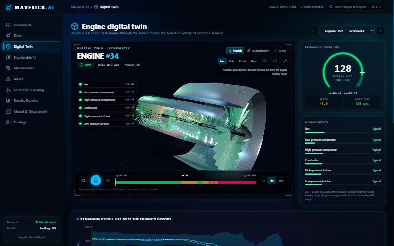
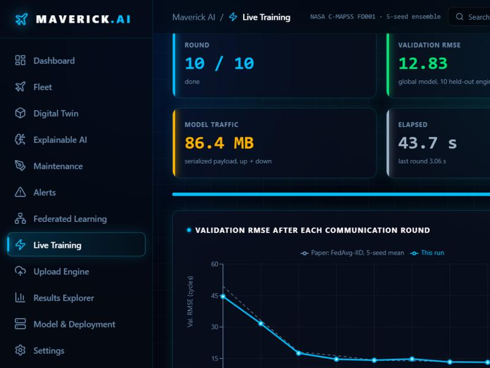
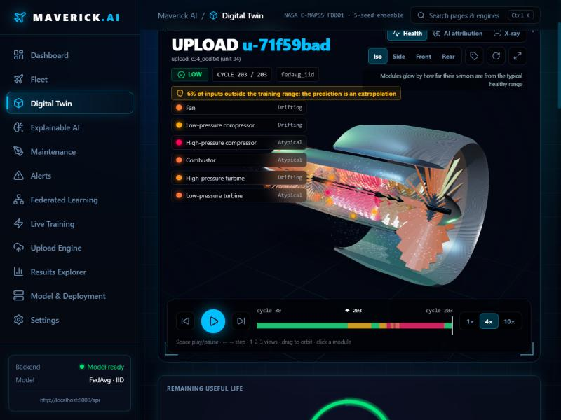
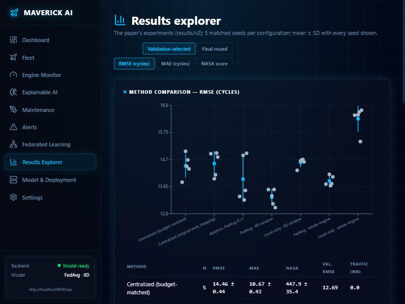
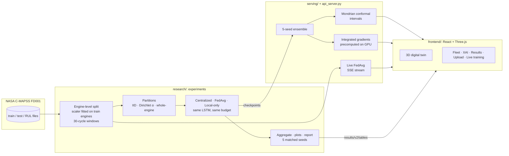
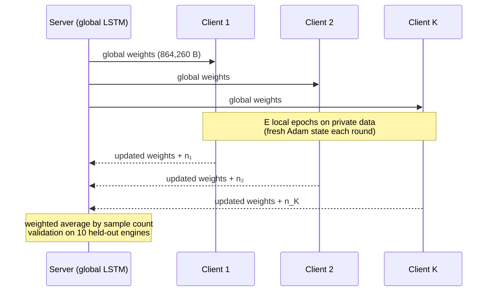

<div align="center">

# ✈️ Maverick AI

### Federated learning for aircraft engine prognostics

Predicting the **remaining useful life (RUL)** of turbofan engines with an LSTM trained by **Federated Averaging**,
served as a 5-seed ensemble with **conformal uncertainty**, **explanations** and an interactive **3D digital twin**.

[](https://github.com/RahulR1826/maverick-ai-rul/actions/workflows/ci.yml)


[Results](#-key-results) ·
[Screenshots](#-the-dashboard) ·
[Architecture](#-architecture) ·
[Quick start](#-quick-start) ·
[Reproduce the paper](#-reproduce-the-paper) ·
[API](#-api) ·
[Limitations](#-limitations)



</div>

---

## 🧭 Why this project

Airlines own large amounts of engine sensor data but are reluctant to pool it. **Federated learning** lets several
operators train one model without moving raw data. This repository asks a careful question:

> *Under a fair, matched protocol, what does federation actually buy for engine prognostics, and at what cost?*

It contains both the **research pipeline** behind the NICEDT-2027 paper and a **dashboard** that serves the trained
models. Every number in the dashboard is computed from the trained models, the NASA data or the paper's result tables.
Nothing is simulated.

> [!IMPORTANT]
> Keeping raw data on clients is **not** a formal privacy guarantee: model updates can leak information. No
> differential privacy or secure aggregation is implemented.

---

## 📊 Key results

Test RMSE on the 100 official FD001 test engines. Mean ± SD over **5 matched seeds**, the same model, the same
validation engines and **the same training budget (100 passes over the data)** for every method.

| Method | RMSE (cycles) | MAE | NASA score |
|---|---|---|---|
| **FedAvg · IID window, 5 clients** | **13.24 ± 0.32** | **9.78 ± 0.21** | **304 ± 27** |
| FedAvg · whole-engine ownership | 13.87 ± 0.19 | 10.15 ± 0.13 | 349 ± 26 |
| Centralized (pooled data) | 14.46 ± 0.44 | 10.67 ± 0.43 | 448 ± 35 |
| Local-only · IID window | 14.58 ± 0.17 | 10.81 ± 0.09 | 415 ± 20 |
| Local-only · an airline with its own 18 engines | 16.28 ± 0.50 | 12.13 ± 0.26 | 652 ± 80 |

<details>
<summary><b>What these numbers mean (click to expand)</b></summary>

- **Federation clearly beats training alone.** An operator with 18 engines reaches 16.28 RMSE; federating with four
  others on the same split reaches 13.87, lower in all 5 seeds.
- **FedAvg also beat centralized training here**, in all 5 seeds, by 1.22 cycles. An ablation (FedAvg with a single
  client, i.e. centralized training with the per-round optimizer reset) does not reproduce this, which points to the
  regularising effect of averaging. The centralized model overfits under the shared, untuned settings. This is **not**
  a claim that federated learning is intrinsically more accurate.
- **Accuracy vs communication:** 20 rounds was best; 30 rounds was no better and costs 50% more traffic. One model
  transfer is 864,260 bytes, so the primary set-up exchanges ~172.9 MB (a payload estimate without protocol overhead).
- **No significance claims:** with 5 seeds the smallest attainable two-sided paired p-value is 0.0625; results are
  reported as mean ± SD and per-seed consistency.

Full report: [`results/v2/EXPERIMENT_REPORT.md`](results/v2/EXPERIMENT_REPORT.md) ·
original-vs-new check: [`results/v2/CONCLUSION_CHECK.md`](results/v2/CONCLUSION_CHECK.md) ·
protocol verification (90/90 checks): [`results/v2/PHASE2_VERIFICATION.md`](results/v2/PHASE2_VERIFICATION.md)

</details>

<p align="center">
  
</p>

<details>
<summary><b>Convergence at equal budget</b></summary>
<p align="center"></p>

The centralized model's validation error is lowest around epoch 45 of 100 and then rises (overfitting), while FedAvg
keeps improving to round 20.
</details>

---

## 🖥️ The dashboard

| Digital twin: healthy (cycle 30) | Digital twin: critical (cycle 203) |
|---|---|
|  |  |
| **Live federated training** | **Your own engine data, flagged when out of range** |
|  |  |

<details>
<summary><b>Everything the dashboard does</b></summary>

| Page | What it shows (all computed live from the models or result files) |
|---|---|
| **Dashboard** | 100-engine fleet constellation, predicted-vs-true calibration plot, highest-risk engines |
| **Digital twin** | Cutaway 3D turbofan; each module glows by its own sensors' deviation from the healthy range; 14 sensors at their NASA station positions; cycle-by-cycle replay; RUL gauge with interval; risk timeline; **AI attribution view** that recolours live during replay; federated vs centralized comparison |
| **Explainable AI** | Integrated-gradients attribution per sensor and per cycle (heat map) |
| **Maintenance / Alerts** | Engines grouped by the conservative (lower) end of the RUL interval; when each engine crossed the threshold |
| **Federated learning** | The paper's convergence curves, client partitions and communication |
| **Live training** | Start a real FedAvg run on the server (GPU if available) and watch each round arrive |
| **Upload engine** | Drag and drop data in the C-MAPSS format; inputs outside the training range are flagged |
| **Results explorer** | Every experiment, every seed, every sweep, paired differences |
| **Model & deployment** | Checkpoint hashes, conformal calibration per RUL range, measured latency, training cost |

Keyboard: <kbd>Ctrl</kbd>+<kbd>K</kbd> opens the command palette · in the twin, <kbd>Space</kbd> plays/pauses,
<kbd>←</kbd>/<kbd>→</kbd> step one cycle, <kbd>1</kbd>/<kbd>2</kbd>/<kbd>3</kbd> switch views.

> [!NOTE]
> The 3D engine is a schematic (not to scale). Spool rotation and airflow particles are illustrative; colours, sensor
> readings, the gauge and attributions come from the data and the models.

</details>

<details>
<summary><b>Results explorer</b></summary>
<p align="center"></p>
</details>

---

## 🏗️ Architecture



<details>
<summary><b>How one FedAvg round works</b></summary>



</details>

<details>
<summary><b>How the uncertainty interval is built</b></summary>

1. Five models (one per seed) predict; take the mean μ and standard deviation σ.
2. On the 10 held-out validation engines, compute normalised residuals |y − μ| / σ.
3. **Mondrian conformal:** for each predicted-RUL range (< 30, 30–60, 60–90, ≥ 90 cycles) take the finite-sample
   90% quantile k. The interval is μ ± k·σ.

On the test engines this covers **89.5%** of all 10,196 cycle predictions (88.2% with a single global k), and near
failure (predicted RUL < 30) the interval is **41% narrower** (18.9 vs 31.9 cycles). Coverage is measured, not
guaranteed: calibration uses windows from only 10 correlated engines. Risk is assigned from the interval's **lower**
bound, which makes it deliberately conservative.

</details>

---

## 🚀 Quick start

> [!NOTE]
> The NASA C-MAPSS data and the trained checkpoints are not stored in this repository. Download the dataset from the
> [NASA Prognostics Data Repository](https://www.nasa.gov/intelligent-systems-division/discovery-and-systems-health/pcoe/pcoe-data-set-repository/)
> and place `train_FD001.txt`, `test_FD001.txt` and `RUL_FD001.txt` in `CMAPSSData/`. Then run the experiments (below)
> to create `checkpoints/v2/`.

<details open>
<summary><b>1 · Install</b></summary>

```bash
pip install -r requirements.txt
```

```bash
npm --prefix frontend install
```
</details>

<details>
<summary><b>2 · Run the dashboard</b></summary>

```bash
python -m serving.precompute
```

```bash
python api_server.py
```

```bash
npm --prefix frontend run dev
```

Open <http://localhost:5173>. The API runs on <http://localhost:8000> (interactive docs at `/docs`).
`serving.precompute` is optional: it builds the per-cycle explanations used for live recolouring (about 75 s per
model on an RTX 4060). To point the UI at another API, copy `frontend/.env.example` to `frontend/.env`.
</details>

<details>
<summary><b>3 · Run the tests</b></summary>

```bash
python -m pytest -q tests
```

```bash
python -m research.verify_phase2
```

52 tests cover preprocessing and leakage checks, partitions, metrics, FedAvg aggregation, conformal intervals,
communication accounting and the API (uploads, comparison, explanations, live training). Tests that need the dataset
or checkpoints are skipped when those are absent.
</details>

---

## 🔬 Reproduce the paper

All settings, experiments, sweeps and seed lists live in [`configs/fd001_protocol.json`](configs/fd001_protocol.json).
Runs are content-addressed and resumable: a finished run is skipped, and nothing is overwritten.

<details open>
<summary><b>Experiment suites</b></summary>

```bash
python -m research.run --suite essential
```

```bash
python -m research.run --suite sweeps
```

```bash
python -m research.run --experiments ablation_fedavg_k1
```

```bash
python -m research.run --suite essential --seed-set fallback
```

Then build the tables, figures, report and manuscript values:

```bash
python -m research.aggregate
```

```bash
python -m research.plots --checkpoint both
```

```bash
python -m research.report
```

```bash
python -m research.paper_tables
```
</details>

<details>
<summary><b>What the protocol guarantees</b></summary>

- [x] Engine-level train/validation split (fixed), scaler fitted on training engines only
- [x] Official test engines used only for final evaluation
- [x] Same model, data, optimiser and **100 passes over the data** for every method
- [x] Same checkpoint-selection rule (validation RMSE every 5 epochs or rounds) for all methods
- [x] 5 matched seeds controlling initialisation, partition, shuffling and dropout
- [x] Every window assigned to exactly one client; minimum client size enforced by redrawing, never by dropping data
- [x] Communication measured as the serialized payload, labelled as an estimate
- [x] Deterministic runs: the same seed reproduces predictions exactly

</details>

<details>
<summary><b>Where the outputs go</b></summary>

| Path | Contents |
|---|---|
| `results/v2/runs/<run_id>/` | Config, metrics, per-round history, per-engine predictions, client partition for every run |
| `results/v2/tables/` | Per-seed and mean ± SD tables, convergence, paired differences |
| `results/v2/figures/` | Publication figures (PNG + PDF) |
| `results/v2/EXPERIMENT_REPORT.md` | The full report with interpretation and limitations |
| `paper/` | Manuscript sections (LaTeX) built from these results |

</details>

---

## 🔌 API

<details>
<summary><b>Endpoints</b></summary>

| Method | Endpoint | Returns |
|---|---|---|
| `GET` | `/api/health` | Status, loaded models, GPU availability, version |
| `GET` | `/api/meta` | Model, calibration per RUL bin, test accuracy, checkpoint hashes |
| `GET` | `/api/fleet` | All 100 test engines with prediction, interval and risk |
| `GET` | `/api/engines/{id}` | Cycle-by-cycle predictions and raw sensors (test engine or upload) |
| `GET` | `/api/engines/{id}/explain` | Integrated gradients for one cycle |
| `GET` | `/api/engines/{id}/attributions` | Attribution for every cycle (precomputed) |
| `GET` | `/api/engines/{id}/compare` | FedAvg vs whole-engine FedAvg vs centralized on one engine |
| `POST` | `/api/uploads` | Analyse engine data in the C-MAPSS format (in memory only) |
| `GET` | `/api/train/stream` | Live FedAvg run, one server-sent event per round |
| `GET` | `/api/results/*` | The paper's result tables |

Full interactive documentation: `http://localhost:8000/docs` while the API is running.
</details>

---

## 📁 Project structure

<details>
<summary><b>Show tree</b></summary>

```text
├── research/          experiment pipeline (data, partitions, trainer, runner, aggregation, plots, report)
├── serving/           model serving: ensemble, conformal intervals, attributions, uploads, live training
├── api_server.py      FastAPI backend
├── frontend/          React + TypeScript + Three.js dashboard
├── configs/           experiment protocol (all settings and seeds)
├── results/v2/        5-seed results, tables, figures, report, verification
├── paper/             manuscript sections and figures
├── tests/             unit and API tests
├── models/            LSTM definition
├── docs/              screenshots and the original pipeline documentation
└── .github/workflows/ continuous integration
```

The original Flower-based pipeline (`main.py`, `federated/`, `run_experiments.py`) is kept for reference; see
[`docs/legacy-pipeline.md`](docs/legacy-pipeline.md).
</details>

---

## ⚠️ Limitations

<details>
<summary><b>Read before citing these results</b></summary>

1. **One subset (FD001):** one operating condition and one fault mode. Results may not transfer to FD002–FD004.
2. **Small validation set:** 10 engines, so checkpoint selection and interval calibration are noisy.
3. **Five seeds:** consistent orderings, but too few for significance testing.
4. **No hyper-parameter tuning** for any method. The centralized baseline overfits under the shared budget, which
   favours FedAvg.
5. **Simulated federation:** full participation, no stragglers or network; communication is a payload estimate.
6. **Synthetic clients:** partitions of one simulated fleet, not real operators.
7. **No formal privacy guarantee:** see the note at the top.
8. **Explanations show what the model relies on**, not physical causes. Modules group sensors by where they are
   measured, not by fault cause.

</details>

---

<div align="center">
<sub>Data: NASA C-MAPSS turbofan degradation simulation (Saxena et al., 2008). Sensor naming follows the C-MAPSS documentation.</sub>
</div>
